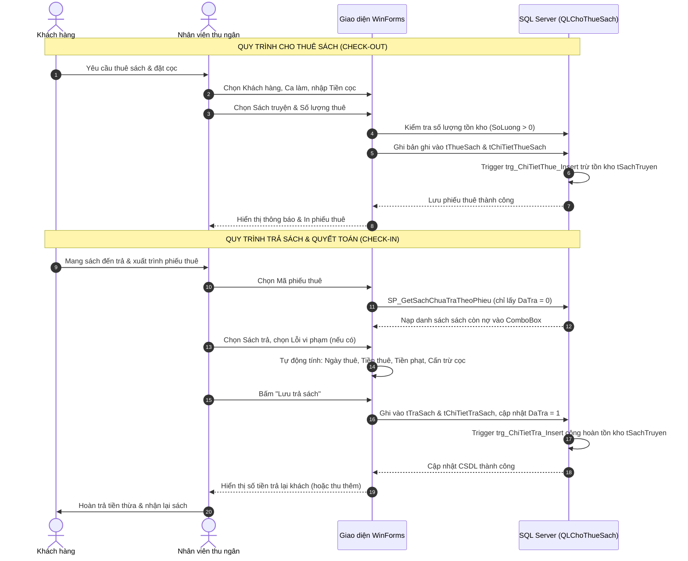
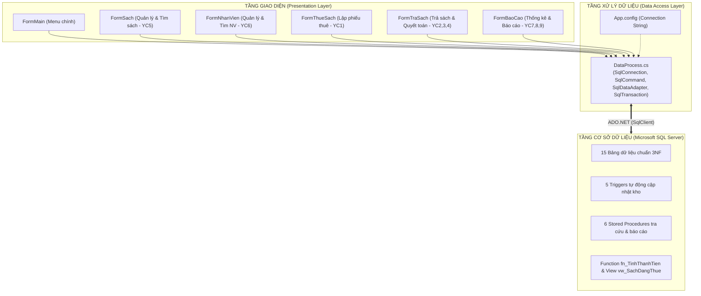

# BỘ GIÁO DỤC VÀ ĐÀO TẠO
# TRƯỜNG ĐẠI HỌC GIAO THÔNG VẬN TẢI HÀ NỘI
## KHOA CÔNG NGHỆ THÔNG TIN
### BỘ MÔN HỆ THỐNG THÔNG TIN & KỸ THUẬT PHẦN MỀM

---

# BÁO CÁO BÀI TẬP LỚN
### HỌC PHẦN: LẬP TRÌNH TRỰC QUAN (C# WINFORMS & SQL SERVER)

## ĐỀ TÀI:
# HỆ THỐNG QUẢN LÝ CỬA HÀNG CHO THUÊ SÁCH TRUYỆN

---

| MÔN HỌC PHẦN | : | Lập trình trực quan |
| :--- | :--- | :--- |
| **TÊN NHÓM THỰC HIỆN** | : | **Nhóm sinh viên thực hiện** |
| **GIẢNG VIÊN HƯỚNG DẪN** | : | **[Điền tên Giảng viên hướng dẫn]** |
| **NĂM THỰC HIỆN** | : | **2026** |
| **THÀNH VIÊN THỰC HIỆN** | : | **1. Đỗ Văn Đạt – [Điền mã SV]** (Trưởng nhóm) **2. Trần Quang Huy – [Điền mã SV]** **3. Lê Minh Đức – [Điền mã SV]** |
| **KHO MÃ NGUỒN GITHUB** | : | [https://github.com/datbuoi/Winform_book-store.git](https://github.com/datbuoi/Winform_book-store.git) |

 

**Hà Nội, năm 2026**

---

\newpage

## LỜI NÓI ĐẦU

Trong những năm gần đây, văn hóa đọc và nhu cầu giải trí thông qua sách truyện, tiểu thuyết, truyện tranh manga - comic và các ấn phẩm phát triển bản thân ngày càng gia tăng trong cộng đồng bạn đọc trẻ tuổi, học sinh và sinh viên. Bên cạnh việc mua sách mới với chi phí đáng kể, mô hình các cửa hàng và chuỗi không gian cho thuê sách truyện truyền thống kết hợp hiện đại vẫn giữ một vị thế quan trọng, mang lại cơ hội tiếp cận tri thức phong phú và đa dạng với mức chi phí tiết kiệm.

Tuy nhiên, tại nhiều cửa hàng cho thuê sách truyện hiện nay, công tác quản lý phần lớn vẫn được thực hiện theo phương thức bán tự động hoặc ghi chép thủ công qua sổ sách và bảng tính Excel rời rạc. Phương thức vận hành này đã bộc lộ hàng loạt bất cập và hạn chế nghiêm trọng:
1. **Kiểm soát biến động tồn kho**: Khi bạn đọc thuê hoặc trả sách, việc cộng/trừ số lượng thủ công rất dễ dẫn đến sai lệch dữ liệu thực tế, tình trạng sách ảo hoặc thậm chí xuất âm kho.
2. **Nghiệp vụ thuê – trả và công nợ phức tạp**: Mỗi lượt thuê sách thường gắn liền với số tiền đặt cọc; khi trả sách phải tính toán chi tiết số ngày thuê thực tế, đơn giá thuê theo ngày, các khoản phụ thu vi phạm (trả trễ hạn, rách bìa, mất trang, hỏng sách...) và đối soát cấn trừ tiền cọc để hoàn trả tiền thừa cho khách. Việc tính toán thủ công rất dễ nhầm lẫn và gây chậm trễ cho khách hàng tại quầy.
3. **Tra cứu và tìm kiếm thông tin**: Việc tra cứu sách theo đa tiêu chí (tên sách, thể loại, lĩnh vực, tác giả, nhà xuất bản) hoặc tra cứu lịch sử nhân viên, khách hàng mất nhiều thời gian do dữ liệu không được lập chỉ mục và liên kết có hệ thống.
4. **Báo cáo và thống kê kinh doanh**: Người quản lý gặp nhiều khó khăn khi muốn theo dõi danh sách sách đang cho thuê chưa thu hồi, thống kê top 5 đầu sách đem lại doanh thu cao nhất hoặc tổng kết doanh thu tiền thuê và tiền phạt theo tháng/năm để kịp thời điều chỉnh kế hoạch nhập sách và kinh doanh.

Xuất phát từ yêu cầu thực tiễn đó, trong khuôn khổ học phần **Lập trình trực quan**, nhóm chúng em đã lựa chọn và thực hiện đề tài: **“Xây dựng Hệ thống Quản lý Cửa hàng Cho thuê Sách Truyện”**. Ứng dụng được thiết kế và hiện thực hóa trên nền tảng **C# Windows Forms (.NET Framework 4.7.2)** kết hợp hệ quản trị cơ sở dữ liệu quan hệ mạnh mẽ **Microsoft SQL Server**, tuân thủ triệt để kiến trúc phân tách mã nguồn rõ ràng, quy chuẩn thiết kế giao diện từ file Designer trực quan và cơ chế kiểm soát toàn vẹn dữ liệu bằng Triggers, Stored Procedures và Functions.

Báo cáo này được cấu trúc thành 5 chương chính:
- **Chương 1**: Tổng quan và khảo sát bài toán quản lý cửa hàng cho thuê sách.
- **Chương 2**: Phân tích yêu cầu hệ thống và quy trình nghiệp vụ (9 yêu cầu cốt lõi).
- **Chương 3**: Thiết kế hệ thống và cơ sở dữ liệu (Kiến trúc phân tầng, 15 bảng chuẩn hóa 3NF, Trigger, SP, Function, View).
- **Chương 4**: Triển khai chức năng và kiểm thử hệ thống (Chi tiết các Form giao diện và ma trận kiểm thử E2E).
- **Chương 5**: Kết luận và định hướng phát triển trong tương lai.

Nhóm chúng em xin chân thành cảm ơn sự đồng hành và hướng dẫn của quý Thầy/Cô bộ môn trong suốt quá trình thực hiện bài tập lớn này!

---

\newpage

## THÔNG TIN NHÓM THỰC HIỆN

Bảng 0.1: Danh sách thành viên nhóm và phân công vai trò

| STT | Họ và tên | Mã sinh viên | Vai trò | Nhiệm vụ chính phụ trách |
| :---: | :--- | :---: | :---: | :--- |
| 1 | **Đỗ Văn Đạt** | *[Điền mã SV]* | Trưởng nhóm | - Khảo sát bài toán, thiết kế kiến trúc tổng thể - Thiết kế CSDL 15 bảng, Trigger, SP, Function - Lập trình FormThueSach, FormTraSach, DataProcess - Quản trị kho mã nguồn Git & tích hợp hệ thống |
| 2 | **Trần Quang Huy** | *[Điền mã SV]* | Thành viên | - Thiết kế giao diện FormSach, FormNhanVien - Lập trình các module tìm kiếm đa tiêu chí (YC5, YC6) - Xây dựng dữ liệu mẫu (Seed Data) chuẩn Unicode - Biên soạn tài liệu kỹ thuật & kiểm thử giao diện |
| 3 | **Lê Minh Đức** | *[Điền mã SV]* | Thành viên | - Thiết kế giao diện FormMain, FormBaoCao - Lập trình xử lý thống kê doanh thu, top 5 sách (YC7, YC8, YC9) - Thiết lập ma trận kiểm thử (E2E Testing Matrix) - Tổng hợp báo cáo bài tập lớn hoàn chỉnh |

---

\newpage

## MỤC LỤC

- **LỜI NÓI ĐẦU**
- **THÔNG TIN NHÓM THỰC HIỆN**
- **DANH MỤC BẢNG BIỂU**
- **DANH MỤC HÌNH ẢNH**
- **CHƯƠNG 1: TỔNG QUAN VÀ KHẢO SÁT BÀI TOÁN**
  - 1.1. Bối cảnh và lý do lựa chọn đề tài
  - 1.2. Hiện trạng và các vấn đề cần giải quyết
  - 1.3. Mục tiêu và phạm vi của hệ thống
  - 1.4. Môi trường phát triển và công nghệ sử dụng
- **CHƯƠNG 2: PHÂN TÍCH YÊU CẦU VÀ QUY TRÌNH NGHIỆP VỤ**
  - 2.1. Các tác nhân và vai trò người dùng (Actors)
  - 2.2. Đặc tả 9 yêu cầu chức năng cốt lõi (YC1 - YC9)
  - 2.3. Đặc tả các yêu cầu phi chức năng
  - 2.4. Quy trình nghiệp vụ Thuê sách và Trả sách khép kín
  - 2.5. Các quy tắc nghiệp vụ và ràng buộc toàn vẹn (Business Rules)
- **CHƯƠNG 3: THIẾT KẾ HỆ THỐNG VÀ CƠ SỞ DỮ LIỆU**
  - 3.1. Thiết kế kiến trúc phần mềm
  - 3.2. Thiết kế mô hình cơ sở dữ liệu quan hệ (15 bảng chuẩn 3NF)
  - 3.3. Từ điển dữ liệu chi tiết các thực thể
  - 3.4. Thiết kế Trigger tự động điều phối tồn kho và giao dịch
  - 3.5. Thiết kế Stored Procedures, View và Function nghiệp vụ
- **CHƯƠNG 4: TRIỂN KHAI CHỨC NĂNG VÀ KIỂM THỬ**
  - 4.1. Tổng quan cấu trúc các Form giao diện trong ứng dụng
  - 4.2. Triển khai phân hệ Điều hướng chính (`FormMain`)
  - 4.3. Triển khai phân hệ Quản lý & Tìm kiếm Sách truyện (`FormSach` - YC5)
  - 4.4. Triển khai phân hệ Quản lý & Tìm kiếm Nhân viên (`FormNhanVien` - YC6)
  - 4.5. Triển khai phân hệ Lập phiếu Cho thuê Sách (`FormThueSach` - YC1, YC2)
  - 4.6. Triển khai phân hệ Xử lý Trả sách & Quyết toán (`FormTraSach` - YC2, YC3, YC4)
  - 4.7. Triển khai phân hệ Báo cáo & Thống kê kinh doanh (`FormBaoCao` - YC7, YC8, YC9)
  - 4.8. Kế hoạch và ma trận kiểm thử hệ thống (Testing Matrix)
  - 4.9. Hướng dẫn cài đặt, cấu hình CSDL và chạy chương trình
- **CHƯƠNG 5: KẾT LUẬN VÀ HƯỚNG PHÁT TRIỂN**
  - 5.1. Kết quả đạt được của đề tài
  - 5.2. Những hạn chế tồn tại
  - 5.3. Hướng phát triển và mở rộng trong tương lai
- **BẢNG PHÂN CÔNG CÔNG VIỆC CHI TIẾT**
- **DANH MỤC TÀI LIỆU THAM KHẢO**

---

\newpage

## DANH MỤC BẢNG BIỂU

- Bảng 0.1: Danh sách thành viên nhóm và phân công vai trò
- Bảng 1.1: Bảng đối chiếu các điểm nghẽn nghiệp vụ và giải pháp công nghệ
- Bảng 1.2: Các nhóm công nghệ và công cụ phát triển phần mềm
- Bảng 2.1: Ma trận phân quyền các tác nhân sử dụng hệ thống
- Bảng 2.2: Bảng đặc tả 9 yêu cầu chức năng nghiệp vụ của đề bài
- Bảng 2.3: Bảng tiêu chí yêu cầu phi chức năng
- Bảng 2.4: Bảng quy định biểu phí vi phạm và bồi hoàn
- Bảng 3.1: Danh mục 15 bảng cơ sở dữ liệu `QLChoThueSach`
- Bảng 3.2: Từ điển dữ liệu bảng Sách truyện (`tSachTruyen`)
- Bảng 3.3: Từ điển dữ liệu bảng Phiếu thuê sách (`tThueSach`)
- Bảng 3.4: Từ điển dữ liệu bảng Chi tiết thuê sách (`tChiTietThueSach`)
- Bảng 3.5: Từ điển dữ liệu bảng Phiếu trả sách (`tTraSach`)
- Bảng 3.6: Từ điển dữ liệu bảng Chi tiết trả sách (`tChiTietTraSach`)
- Bảng 3.7: Từ điển dữ liệu bảng Nhân viên (`tNhanVien`)
- Bảng 3.8: Từ điển dữ liệu bảng Khách hàng (`tKhachHang`)
- Bảng 3.9: Danh mục các Trigger tự động cập nhật tồn kho
- Bảng 3.10: Danh mục các Stored Procedure, View và Function
- Bảng 4.1: Danh sách các Form và thành phần giao diện WinForms
- Bảng 4.2: Ma trận kiểm thử chức năng tự động và thủ công (E2E Test)
- Bảng 4.3: Các bước kiểm thử nghiệm thu trực tiếp trên máy chấm bài
- Bảng 5.1: Bảng phân công tiến độ và tỷ lệ hoàn thành công việc

---

\newpage

## DANH MỤC HÌNH ẢNH

- Hình 1.1: Chu trình nghiệp vụ tổng quát của Cửa hàng cho thuê sách
- Hình 2.1: Sơ đồ luồng xử lý quy trình Cho thuê sách (Check-out)
- Hình 2.2: Sơ đồ luồng xử lý quy trình Trả sách & Cấn trừ cọc (Check-in)
- Hình 3.1: Kiến trúc phân tầng (Presentation - Data Access Layer - SQL Server Database)
- Hình 3.2: Sơ đồ mô hình quan hệ thực thể (Entity Relationship Diagram - ERD)
- Hình 4.1: Giao diện Menu điều hướng chính (`FormMain`)
- Hình 4.2: Giao diện Quản lý và Tìm kiếm Sách truyện (`FormSach`)
- Hình 4.3: Giao diện Quản lý và Tra cứu Nhân viên (`FormNhanVien`)
- Hình 4.4: Giao diện Lập phiếu Thuê sách (`FormThueSach`)
- Hình 4.5: Giao diện Xử lý Trả sách và Quyết toán tiền thừa (`FormTraSach`)
- Hình 4.6: Giao diện Thống kê và Báo cáo Doanh thu (`FormBaoCao`)

---

\newpage

# CHƯƠNG 1: TỔNG QUAN VÀ KHẢO SÁT BÀI TOÁN

## 1.1. Bối cảnh và lý do lựa chọn đề tài
Trong thời đại chuyển đổi số mạnh mẽ, ứng dụng công nghệ thông tin vào công tác quản trị kinh doanh dịch vụ đã trở thành một yêu cầu cấp bách. Mô hình cho thuê sách truyện đòi hỏi sự quản lý tỉ mỉ vì các sản phẩm cho thuê sau một chu kỳ lưu hành sẽ quay trở lại kho; đồng thời mỗi cuốn sách có các tình trạng vật lý khác nhau (mới, cũ, rách mép, mất trang...) và gắn liền với quyền lợi tiền đặt cọc của khách hàng.

Nếu quản lý theo phương thức truyền thống, cửa hàng rất dễ xảy ra tình trạng:
- Không nắm bắt được tức thời số lượng sách truyện còn trong kho để tư vấn cho khách.
- Khó kiểm soát những đầu sách đã cho thuê quá hạn mà khách hàng chưa mang trả.
- Việc tính toán phí thuê theo số ngày và phạt vi phạm khi khách trả sách dễ xảy ra sai sót, tranh cãi.
- Thiếu các số liệu tổng hợp định kỳ về doanh thu và mức độ quan tâm của độc giả đối với từng thể loại, tác giả, nhà xuất bản.

Vì vậy, việc tin học hóa toàn diện quy trình cho thuê sách truyện là giải pháp cần thiết, giúp nâng cao năng suất của nhân viên thu ngân/thủ kho và tăng cường sự hài lòng, minh bạch cho khách hàng.

## 1.2. Hiện trạng và các vấn đề cần giải quyết
Qua quá trình khảo sát nghiệp vụ thực tế của mô hình cửa hàng cho thuê sách truyện, nhóm chúng em đã tổng hợp các điểm nghẽn và đề xuất giải pháp xử lý bằng phần mềm như sau:

Bảng 1.1: Bảng đối chiếu các điểm nghẽn nghiệp vụ và giải pháp công nghệ

| STT | Vấn đề trong quản lý thực tế | Rủi ro & Hạn chế | Giải pháp công nghệ trong phần mềm |
| :---: | :--- | :--- | :--- |
| 1 | Quản lý danh mục sách truyện nhiều thuộc tính (lĩnh vực, tác giả, NXB, ngôn ngữ, tình trạng...) | Dễ nhập sai chính tả, dữ liệu trùng lặp, khó phân loại | Chuẩn hóa CSDL quan hệ 3NF với các bảng danh mục riêng biệt, nạp tự động qua ComboBox |
| 2 | Biến động tồn kho khi khách thuê/trả | Dễ quên cộng/trừ số lượng, dẫn đến xuất âm kho | Cơ chế Trigger tại SQL Server tự động trừ kho khi thuê và cộng hoàn kho khi trả |
| 3 | Lọc sách trả theo phiếu thuê | Nhân viên mất thời gian dò sổ xem khách đã thuê những quyển nào | Lọc động chỉ hiển thị các sách thuộc phiếu thuê **đang còn nợ chưa trả** (`DaTra = 0`) |
| 4 | Quyết toán tiền thuê và tiền cọc | Nhầm lẫn khi nhân số ngày thuê, phụ thu phạt vi phạm | Tự động tính số ngày thuê, tiền thuê theo công thức, cộng tiền phạt và đối soát tiền cọc |
| 5 | Tra cứu đa tiêu chí | Tìm kiếm thủ công chậm chạp khi số lượng đầu sách lớn | Stored Procedure tìm kiếm kết hợp nhiều điều kiện động theo tên, lĩnh vực, tác giả, NXB |
| 6 | Báo cáo doanh thu & nợ sách | Mất nhiều giờ tổng hợp sổ sách cuối tháng | View và Stored Procedure tổng hợp tức thời báo cáo sách chưa trả, top 5 doanh thu, doanh thu tháng/năm |

## 1.3. Mục tiêu và phạm vi của hệ thống
### 1.3.1. Mục tiêu tổng quát
Xây dựng một phần mềm quản lý máy trạm (Desktop Application) chạy trên hệ điều hành Windows, có giao diện đồ họa thân thiện, dễ sử dụng, kết nối cơ sở dữ liệu SQL Server tập trung, đáp ứng đầy đủ và vượt trội 9 yêu cầu nghiệp vụ do đề bài đề ra.

### 1.3.2. Mục tiêu cụ thể
- Cung cấp giao diện trực quan cho nhân viên thực hiện các thao tác: Quản lý sách truyện, Quản lý nhân sự, Lập phiếu thuê sách, Xử lý trả sách, Tra cứu và Báo cáo.
- Đảm bảo 100% các điều khiển (Controls) trên giao diện được thiết kế thông qua công cụ kéo thả trực quan (`Designer.cs`), không phát sinh control động bằng mã lệnh runtime.
- Đảm bảo độ tin cậy và toàn vẹn dữ liệu: Tất cả chuỗi văn bản lưu trữ và hiển thị đều đạt chuẩn tiếng Việt có dấu Unicode UTF-8/NVARCHAR.
- Thực hiện đóng gói và quản lý mã nguồn chuyên nghiệp trên GitHub.

### 1.3.3. Phạm vi đề tài
- **Phạm vi nghiệp vụ**: Quản lý nghiệp vụ tại quầy cho thuê sách truyện (quản lý kho, quản lý danh mục, lập phiếu thuê, xử lý phiếu trả, phạt vi phạm, tìm kiếm và thống kê báo cáo).
- **Phạm vi kỹ thuật**: Ứng dụng WinForms chạy trên môi trường desktop kết nối Microsoft SQL Server nội bộ (Local / LAN).

## 1.4. Môi trường phát triển và công nghệ sử dụng
Bảng 1.2: Các nhóm công nghệ và công cụ phát triển phần mềm

| Thành phần | Công nghệ / Công cụ lựa chọn | Phiên bản / Ghi chú |
| :--- | :--- | :--- |
| **Hệ điều hành** | Microsoft Windows 10 / Windows 11 | 64-bit |
| **Môi trường phát triển (IDE)** | Microsoft Visual Studio 2022 | Hỗ trợ WinForms Designer trực quan |
| **Nền tảng thực thi** | .NET Framework | Phiên bản 4.7.2 (C# 7.3+) |
| **Công nghệ giao diện** | Windows Forms (GDI+) | Sử dụng các điều khiển chuẩn: Form, MenuStrip, DataGridView, ComboBox, TextBox, DateTimePicker... |
| **Hệ quản trị CSDL** | Microsoft SQL Server | SQL Server Express / Developer 2019/2022 |
| **Thư viện kết nối CSDL** | ADO.NET (`System.Data.SqlClient`) | Thực thi kết nối qua `SqlConnection`, `SqlCommand`, `SqlDataAdapter`, `SqlTransaction` |
| **Quản lý mã nguồn** | Git & GitHub | Kho mã nguồn công khai, quản lý phiên bản chuẩn |

---

\newpage

# CHƯƠNG 2: PHÂN TÍCH YÊU CẦU VÀ QUY TRÌNH NGHIỆP VỤ

## 2.1. Các tác nhân và vai trò người dùng (Actors)
Hệ thống xác định 2 tác nhân người dùng chính tham gia vận hành:
1. **Nhân viên thu ngân / quản lý quầy**:
   - Tiếp nhận yêu cầu thuê sách của khách hàng, kiểm tra tính khả dụng của sách, lập phiếu thuê và thu tiền đặt cọc.
   - Tiếp nhận sách trả, kiểm tra tình trạng thực tế của sách, ghi nhận vi phạm (nếu có), tính toán tiền thuê và thanh toán hoàn cọc cho khách.
   - Tra cứu nhanh thông tin sách truyện và nhân viên ca trực.
2. **Người quản lý / Quản trị viên (Store Manager)**:
   - Quản lý danh mục sách truyện (thêm mới, cập nhật giá sách, giá thuê, số lượng tồn kho).
   - Quản lý hồ sơ nhân viên và ca làm việc.
   - Khai thác các báo cáo quản trị: Xem danh sách sách cho thuê chưa trả, top 5 sách có doanh thu cao nhất, tổng hợp doanh thu theo tháng và năm.

Bảng 2.1: Ma trận phân quyền các tác nhân sử dụng hệ thống

| Phân hệ chức năng | Nhân viên thu ngân | Quản lý cửa hàng |
| :--- | :---: | :---: |
| Quản lý & tra cứu Sách truyện | Tra cứu | Xem, Thêm, Sửa, Xóa, Tra cứu |
| Quản lý & tra cứu Nhân viên | Tra cứu | Xem, Thêm, Sửa, Xóa, Tra cứu |
| Nghiệp vụ Cho thuê sách (Lập phiếu thuê) | Toàn quyền | Toàn quyền |
| Nghiệp vụ Trả sách & Quyết toán | Toàn quyền | Toàn quyền |
| Báo cáo sách chưa trả | Xem | Xem, Xuất báo cáo |
| Báo cáo Top 5 sách doanh thu cao nhất | Xem | Xem, Xuất báo cáo |
| Báo cáo Doanh thu tiền thuê & phạt theo kỳ | Xem | Xem, Xuất báo cáo |

## 2.2. Đặc tả 9 yêu cầu chức năng cốt lõi (YC1 - YC9)
Theo đặc tả của đề bài, hệ thống đáp ứng đầy đủ và chính xác 9 yêu cầu nghiệp vụ:

Bảng 2.2: Bảng đặc tả 9 yêu cầu chức năng nghiệp vụ của đề bài

| Mã YC | Tên yêu cầu nghiệp vụ | Mô tả chi tiết hành vi của hệ thống |
| :---: | :--- | :--- |
| **YC1** | **Lập phiếu cho thuê sách** | Cho phép nhân viên chọn khách hàng, ca trực, ngày thuê, nhập tiền cọc; chọn các sách truyện cần thuê và số lượng. Hệ thống lưu phiếu thuê và chi tiết thuê; tự động giảm số lượng tồn kho của sách tương ứng. |
| **YC2** | **Lập phiếu trả sách và tính tiền** | Cho phép chọn phiếu thuê cần trả, chọn các sách được trả, ghi nhận lỗi vi phạm (nếu có). Hệ thống tự động tính tiền thuê theo số ngày, tiền phạt, cấn trừ tiền cọc và đưa ra số tiền cuối cùng cần thanh toán/trả lại cho khách. Cập nhật trạng thái `DaTra = 1` và tự động cộng hoàn tồn kho. |
| **YC3** | **Lọc sách đang thuê chưa trả** | Khi nhân viên chọn mã phiếu thuê tại màn hình trả sách, danh sách sách truyện hiển thị trong ComboBox **chỉ bao gồm những sách thuộc phiếu thuê đó mà chưa được trả** (`DaTra = 0`), tuyệt đối không hiển thị lại sách đã trả. |
| **YC4** | **Công thức tính tiền thuê và phạt** | Áp dụng đúng công thức nghiệp vụ: $$\text{Số ngày thuê} = \text{NgayTra} - \text{NgayThue}$$ (nếu cùng ngày thì tính là 1 ngày). $$\text{Tiền thuê} = \text{Đơn giá thuê/ngày} \times \text{Số ngày thuê} \times \text{Số lượng}$$ $$\text{Tổng thanh toán} = \text{Tiền thuê} + \text{Tiền phạt vi phạm}$$ $$\text{Tiền trả lại khách} = \text{Tiền cọc} - \text{Tổng thanh toán}$$ (nếu âm thì khách phải nộp thêm). |
| **YC5** | **Tìm kiếm Sách truyện đa tiêu chí** | Hỗ trợ tìm kiếm kết hợp linh hoạt giữa các tiêu chí: Tên sách (gần đúng), Lĩnh vực, Tác giả, Nhà xuất bản. Nếu để trống tiêu chí nào thì hệ thống tự động bỏ qua tiêu chí đó. |
| **YC6** | **Tìm kiếm Nhân viên đa tiêu chí** | Hỗ trợ tra cứu nhân viên theo: Tên nhân viên (gần đúng), Địa chỉ / Quê quán (gần đúng), Năm sinh (chính xác). |
| **YC7** | **Báo cáo sách đang thuê chưa trả** | Thống kê danh sách toàn bộ sách truyện đang được bạn đọc thuê nhưng chưa hoàn trả về cửa hàng, bao gồm: Mã sách, Tên sách, Mã phiếu thuê, Tên khách hàng, Ngày thuê, Số lượng nợ, Số ngày đã thuê tính đến hiện tại. |
| **YC8** | **Báo cáo Top 5 sách doanh thu cao nhất** | Thống kê 5 đầu sách mang lại tổng doanh thu tiền thuê lớn nhất trong một khoảng thời gian được người dùng lựa chọn (Từ ngày ... Đến ngày ...). |
| **YC9** | **Báo cáo Doanh thu tiền thuê và tiền phạt** | Tổng hợp doanh thu chi tiết theo Tháng và Năm được chọn, phân tách rõ ràng: Tổng tiền thuê sách, Tổng tiền phạt vi phạm và Tổng doanh thu thực nhận. |

## 2.3. Đặc tả các yêu cầu phi chức năng
Bảng 2.3: Bảng tiêu chí yêu cầu phi chức năng

| Tiêu chuẩn | Yêu cầu kỹ thuật | Cách tiếp cận hiện thực |
| :--- | :--- | :--- |
| **Tính toàn vẹn dữ liệu** | Không để xảy ra xuất âm kho, không làm sai lệch tồn kho khi hủy/sửa giao dịch | Sử dụng Database Triggers kết hợp `ROLLBACK TRANSACTION` trong SQL Server |
| **Hiển thị tiếng Việt** | 100% giao diện và dữ liệu cơ sở dữ liệu hiển thị tiếng Việt có dấu chuẩn | Mã hóa file nguồn UTF-8 BOM (`utf-8-sig`), lưu cột kiểu `NVARCHAR`, dùng tiền tố `N'...'` |
| **Tuân thủ thiết kế WinForms** | Tất cả control tạo bằng Visual Studio Designer kéo thả | Mọi thuộc tính nằm trong `InitializeComponent()` của `*.Designer.cs`, không sinh control từ code-behind |
| **Hiệu năng đáp ứng** | Thao tác tra cứu, lưu phiếu, xuất báo cáo dưới 1 giây | Tối ưu hóa câu truy vấn bằng Stored Procedure và Index khóa chính/khóa ngoại |
| **Trải nghiệm người dùng (UX)** | Giao diện rõ ràng, phân vùng thông tin mạch lạc, phím tắt thao tác nhanh | Bố cục Form theo GroupBox logic: Nhập liệu ở trên, Danh sách ở dưới, Nút bấm chuẩn màu |

## 2.4. Quy trình nghiệp vụ Thuê sách và Trả sách khép kín

## 2.5. Các quy tắc nghiệp vụ và ràng buộc toàn vẹn (Business Rules)
1. **Ràng buộc tồn kho**: Khách hàng chỉ được thuê sách khi số lượng tồn kho của đầu sách đó lớn hơn hoặc bằng số lượng yêu cầu thuê ($SoLuongTon \ge SoLuongThue$).
2. **Ràng buộc hoàn trả**: Một cuốn sách trong chi tiết phiếu thuê chỉ được phép trả một lần; khi đã trả (`DaTra = 1`), sách này sẽ bị loại bỏ khỏi danh sách được phép trả của phiếu đó.
3. **Quy định tính thời gian thuê**:
   - Nếu trả cùng ngày thuê ($NgayTra = NgayThue$): Tính tròn là 1 ngày thuê.
   - Nếu trả khác ngày: $SoNgay = \text{DATEDIFF}(day, NgayThue, NgayTra)$.
4. **Quy định biểu phí vi phạm**:

Bảng 2.4: Bảng quy định biểu phí vi phạm và bồi hoàn

| Mã vi phạm | Tên hành vi vi phạm | Mức phạt quy định (VNĐ) |
| :---: | :--- | :---: |
| **VP000** | Trả sách đúng hẹn, sách nguyên vẹn bình thường | 0 đ |
| **VP001** | Rách bìa / bong gáy nhẹ | 10.000 đ |
| **VP002** | Mất trang / bẩn nhiều trang | 25.000 đ |
| **VP003** | Mất sách (Bồi hoàn nguyên giá trị bìa) | 80.000 đ |
| **VP004** | Trả muộn quá hạn quy định | 15.000 đ |
| **VP005** | Vẽ bậy / gập mép sách làm biến dạng | 5.000 đ |

---

\newpage

# CHƯƠNG 3: THIẾT KẾ HỆ THỐNG VÀ CƠ SỞ DỮ LIỆU

## 3.1. Thiết kế kiến trúc phần mềm
Hệ thống được tổ chức theo kiến trúc phân tách rõ ràng giữa tầng giao diện hiển thị và tầng truy xuất dữ liệu:
- **Tầng giao diện (Presentation Layer - Forms)**:
  Bao gồm các Form nghiệp vụ: `FormMain`, `FormSach`, `FormNhanVien`, `FormThueSach`, `FormTraSach`, `FormBaoCao`. Mỗi Form được cấu thành bởi 2 file:
  - `FormXxx.Designer.cs`: Định nghĩa toàn bộ cây điều khiển, tọa độ, font chữ, thuộc tính kích thước được sinh ra từ quá trình kéo thả của Visual Studio Designer.
  - `FormXxx.cs`: Chứa mã lệnh xử lý sự kiện (Event Handlers), gọi các hàm xử lý dữ liệu từ lớp `DataProcess`.
- **Tầng xử lý dữ liệu (Data Access Layer - `DataProcess.cs`)**:
  Đóng gói toàn bộ các thao tác tương tác với SQL Server thông qua thư viện chuẩn `System.Data.SqlClient`. Lớp cung cấp các phương thức tái sử dụng cao:
  - `DocBang(string sql)`: Trả về một `DataTable` để đổ dữ liệu vào DataGridView hoặc ComboBox.
  - `CapNhatDuLieu(string sql, SqlParameter[] parameters)`: Thực thi các câu lệnh thêm, sửa, xóa có tham số chống SQL Injection.
  - `ThucThiGiaTri(string sql, SqlParameter[] parameters)`: Trả về giá trị đơn lẻ (`ExecuteScalar`).
  - `ThucThiStoredProcedure(string spName, SqlParameter[] parameters)`: Gọi trực tiếp các Stored Procedure của SQL Server.
- **Tầng cơ sở dữ liệu (Database Layer - SQL Server `QLChoThueSach`)**:
  Chứa 15 bảng chuẩn hóa, khóa chính, khóa ngoại, Triggers, Views, Functions và Stored Procedures.

## 3.2. Thiết kế mô hình cơ sở dữ liệu quan hệ (15 bảng chuẩn 3NF)
Hệ thống sử dụng cơ sở dữ liệu `QLChoThueSach` gồm 15 bảng được thiết kế chuẩn hóa, loại bỏ hoàn toàn dư thừa dữ liệu:

Bảng 3.1: Danh mục 15 bảng cơ sở dữ liệu `QLChoThueSach`

| STT | Tên bảng | Tên tiếng Việt | Khóa chính (PK) | Khóa ngoại (FK) | Chức năng nghiệp vụ |
| :---: | :--- | :--- | :---: | :---: | :--- |
| 1 | `tLinhVuc` | Lĩnh vực sách | `MaLV` | Không | Phân loại lĩnh vực (Manga, Trinh thám, Kinh điển...) |
| 2 | `tLoaiSach` | Loại sách truyện | `MaLoai` | Không | Phân loại tính chất sách (Mới, Cũ, Hot, Sưu tầm...) |
| 3 | `tTinhTrang` | Tình trạng sách | `MaTT` | Không | Mô tả độ mới (Mới 99%, Bình thường, Hơi cũ...) |
| 4 | `tNgonNgu` | Ngôn ngữ | `MaNN` | Không | Ngôn ngữ phát hành (Tiếng Việt, Tiếng Anh...) |
| 5 | `tTacGia` | Tác giả | `MaTG` | Không | Lưu thông tin tác giả sáng tác |
| 6 | `tNXB` | Nhà xuất bản | `MaNXB` | Không | Thông tin đơn vị phát hành |
| 7 | `tCaLam` | Ca làm việc | `MaCa` | Không | Phân chia ca trực (Sáng, Chiều, Tối) |
| 8 | `tViPham` | Danh mục vi phạm | `MaVP` | Không | Bảng giá quy định các mức phạt vi phạm |
| 9 | `tKhachHang` | Khách hàng | `MaKH` | Không | Thông tin độc giả đến thuê sách |
| 10 | `tNhanVien` | Nhân viên | `MaNV` | Không | Hồ sơ nhân viên phục vụ tại cửa hàng |
| 11 | `tSachTruyen` | Sách truyện | `MaSach` | `MaLoai, MaLV, MaTG, MaNXB, MaNN, MaTT` | Bảng sản phẩm trung tâm của kho sách |
| 12 | `tThueSach` | Phiếu cho thuê sách | `MaThue` | `MaKH, MaNV, MaCa` | Đầu phiếu ghi nhận lượt thuê sách và tiền cọc |
| 13 | `tChiTietThueSach`| Chi tiết thuê sách | `(MaThue, MaSach)` | `MaThue, MaSach` | Danh sách các cuốn sách và số lượng thuê |
| 14 | `tTraSach` | Phiếu trả sách | `MaTra` | `MaThue, MaNV` | Đầu phiếu ghi nhận lượt trả sách |
| 15 | `tChiTietTraSach` | Chi tiết trả sách | `(MaTra, MaSach)` | `MaTra, MaSach, MaVP` | Danh sách sách trả, lỗi vi phạm và thành tiền |

## 3.3. Từ điển dữ liệu chi tiết các thực thể

### 3.3.1. Bảng Sách truyện (`tSachTruyen`)
Bảng 3.2: Từ điển dữ liệu bảng Sách truyện (`tSachTruyen`)

| Thuộc tính | Tên mô tả | Kiểu dữ liệu | Ràng buộc | Diễn giải nghiệp vụ |
| :--- | :--- | :--- | :---: | :--- |
| `MaSach` | Mã sách | `CHAR(8)` | **PK, NOT NULL** | Mã định danh duy nhất (VD: S25-0001) |
| `TenSach` | Tên sách truyện | `NVARCHAR(150)` | NOT NULL | Tên tác phẩm sách truyện |
| `MaLoai` | Mã loại sách | `CHAR(4)` | **FK**, NOT NULL | Tham chiếu đến bảng `tLoaiSach` |
| `MaLV` | Mã lĩnh vực | `CHAR(4)` | **FK**, NOT NULL | Tham chiếu đến bảng `tLinhVuc` |
| `MaTG` | Mã tác giả | `CHAR(6)` | **FK**, NOT NULL | Tham chiếu đến bảng `tTacGia` |
| `MaNXB` | Mã nhà xuất bản | `CHAR(6)` | **FK**, NOT NULL | Tham chiếu đến bảng `tNXB` |
| `MaNN` | Mã ngôn ngữ | `CHAR(4)` | **FK**, NOT NULL | Tham chiếu đến bảng `tNgonNgu` |
| `SoTrang` | Số trang | `INT` | $\ge 0$ | Dung lượng số trang của sách |
| `GiaSach` | Giá bìa của sách | `MONEY` | $\ge 0$ | Giá trị bìa sách (dùng đền bù khi mất) |
| `DonGiaThue`| Đơn giá thuê/ngày | `MONEY` | $\ge 0$ | Đơn giá thuê tính cho 1 cuốn trong 1 ngày |
| `MaTT` | Mã tình trạng | `CHAR(4)` | **FK**, NOT NULL | Tham chiếu đến bảng `tTinhTrang` |
| `SoLuong` | Số lượng tồn kho | `INT` | $\ge 0$ | Số lượng sách thực tế hiện có trong kho |
| `Anh` | Đường dẫn ảnh bìa | `NVARCHAR(200)` | NULL | Tên tệp hoặc đường dẫn ảnh bìa |
| `GhiChu` | Ghi chú thêm | `NVARCHAR(255)` | NULL | Mô tả thêm về đặc điểm sách |

### 3.3.2. Bảng Phiếu thuê sách (`tThueSach`) & Chi tiết thuê (`tChiTietThueSach`)
Bảng 3.3: Từ điển dữ liệu bảng Phiếu thuê sách (`tThueSach`)

| Thuộc tính | Tên mô tả | Kiểu dữ liệu | Ràng buộc | Diễn giải nghiệp vụ |
| :--- | :--- | :--- | :---: | :--- |
| `MaThue` | Mã phiếu thuê | `CHAR(10)` | **PK, NOT NULL** | Mã duy nhất (VD: TH25100001) |
| `MaKH` | Mã khách hàng | `CHAR(8)` | **FK**, NOT NULL | Khách hàng thực hiện thuê |
| `MaNV` | Mã nhân viên | `CHAR(7)` | **FK**, NOT NULL | Nhân viên lập phiếu thuê |
| `MaCa` | Mã ca làm việc | `CHAR(4)` | **FK**, NOT NULL | Ca trực phát sinh giao dịch |
| `NgayThue` | Ngày thuê sách | `DATE` | NOT NULL | Ngày khách bắt đầu nhận sách |
| `TienDatCoc`| Tiền đặt cọc | `MONEY` | $\ge 0$ | Tiền cọc khách gửi lại cửa hàng |

Bảng 3.4: Từ điển dữ liệu bảng Chi tiết thuê sách (`tChiTietThueSach`)

| Thuộc tính | Tên mô tả | Kiểu dữ liệu | Ràng buộc | Diễn giải nghiệp vụ |
| :--- | :--- | :--- | :---: | :--- |
| `MaThue` | Mã phiếu thuê | `CHAR(10)` | **PK, FK** | Thuộc phiếu thuê nào |
| `MaSach` | Mã sách | `CHAR(8)` | **PK, FK** | Cuốn sách được thuê |
| `SoLuong` | Số lượng thuê | `INT` | $> 0$ | Số lượng cuốn thuê của đầu sách |
| `DaTra` | Trạng thái đã trả | `BIT` | DEFAULT 0 | 0: Đang thuê chưa trả; 1: Đã trả |

### 3.3.3. Bảng Phiếu trả sách (`tTraSach`) & Chi tiết trả (`tChiTietTraSach`)
Bảng 3.5: Từ điển dữ liệu bảng Phiếu trả sách (`tTraSach`)

| Thuộc tính | Tên mô tả | Kiểu dữ liệu | Ràng buộc | Diễn giải nghiệp vụ |
| :--- | :--- | :--- | :---: | :--- |
| `MaTra` | Mã phiếu trả | `CHAR(10)` | **PK, NOT NULL** | Mã duy nhất (VD: TR25100001) |
| `MaThue` | Mã phiếu thuê | `CHAR(10)` | **FK**, NOT NULL | Phiếu thuê tương ứng được thanh toán |
| `MaNV` | Mã nhân viên | `CHAR(7)` | **FK**, NOT NULL | Nhân viên nhận trả và quyết toán |
| `NgayTra` | Ngày thực tế trả | `DATE` | NOT NULL | Ngày khách mang sách đến trả |
| `TongTienTra`| Tổng tiền hoàn lại | `MONEY` | NULL | Tiền thừa hoàn cọc (hoặc thu thêm) |

Bảng 3.6: Từ điển dữ liệu bảng Chi tiết trả sách (`tChiTietTraSach`)

| Thuộc tính | Tên mô tả | Kiểu dữ liệu | Ràng buộc | Diễn giải nghiệp vụ |
| :--- | :--- | :--- | :---: | :--- |
| `MaTra` | Mã phiếu trả | `CHAR(10)` | **PK, FK** | Thuộc phiếu trả nào |
| `MaSach` | Mã sách trả | `CHAR(8)` | **PK, FK** | Cuốn sách được hoàn trả |
| `MaVP` | Mã lỗi vi phạm | `CHAR(5)` | **FK**, NOT NULL | Lỗi vi phạm phát sinh (mặc định VP000) |
| `ThanhTien` | Tiền thuê + Tiền phạt | `MONEY` | $\ge 0$ | Tổng tiền phải trả cho cuốn sách này |

## 3.4. Thiết kế Trigger tự động điều phối tồn kho và giao dịch
Để loại bỏ triệt để tình trạng lệch tồn kho, cơ sở dữ liệu `QLChoThueSach` được thiết lập 5 Triggers xử lý trực tiếp tại tầng CSDL:

Bảng 3.9: Danh mục các Trigger tự động cập nhật kho

| Tên Trigger | Tác động trên bảng | Sự kiện | Hành vi xử lý nghiệp vụ |
| :--- | :--- | :---: | :--- |
| `trg_ChiTietThue_Insert` | `tChiTietThueSach` | **AFTER INSERT** | - Kiểm tra số lượng tồn kho: Nếu tồn kho < số lượng thuê thì `ROLLBACK TRANSACTION` và báo lỗi. - Nếu hợp lệ: Tự động trừ tồn kho: `SoLuong = SoLuong - inserted.SoLuong`. |
| `trg_ChiTietThue_Delete` | `tChiTietThueSach` | **AFTER DELETE** | - Khi xóa một dòng chi tiết thuê (hủy thuê): Tự động hoàn trả số lượng lại kho cho cuốn sách đó. |
| `trg_ChiTietTra_Insert` | `tChiTietTraSach` | **AFTER INSERT** | - Khi khách trả sách: Tự động cộng hoàn trả tồn kho: `SoLuong = SoLuong + 1`. - Tự động cập nhật `DaTra = 1` trong bảng `tChiTietThueSach` cho cuốn sách đó. |
| `trg_ChiTietTra_Delete` | `tChiTietTraSach` | **AFTER DELETE** | - Khi hủy một dòng chi tiết trả: Tự động trừ lại tồn kho và đưa trạng thái `DaTra = 0`. |

## 3.5. Thiết kế Stored Procedures, View và Function nghiệp vụ
Bảng 3.10: Danh mục các Stored Procedure, View và Function

| Loại | Tên đối tượng | Tham số đầu vào | Mục đích nghiệp vụ phục vụ |
| :--- | :--- | :--- | :--- |
| **Function** | `fn_TinhThanhTien` | `@MaThue, @MaSach, @NgayTra, @MaVP` | Tính toán thành tiền thuê sách theo đúng công thức: `(DonGiaThue * SoNgay) + TienPhat`. |
| **View** | `vw_SachDangThueChuaTra` | Không | Tổng hợp danh sách toàn bộ các đầu sách đang được thuê mà chưa trả (`DaTra = 0`) phục vụ **YC7**. |
| **Procedure**| `SP_TimSach` | `@TenSach, @MaLV, @MaTG, @MaNXB` | Tìm kiếm kết hợp linh hoạt đa tiêu chí cho sách truyện phục vụ **YC5**. |
| **Procedure**| `SP_TimNhanVien` | `@TenNV, @DiaChi, @NamSinh` | Tìm kiếm nhân viên đa tiêu chí phục vụ **YC6**. |
| **Procedure**| `SP_GetSachChuaTraTheoPhieu`| `@MaThue` | Truy vấn danh sách sách **chưa trả** của một phiếu thuê cụ thể phục vụ đổ ComboBox **YC3**. |
| **Procedure**| `SP_Top5SachDoanhThu` | `@TuNgay, @DenNgay` | Thống kê top 5 sách truyện có tổng doanh thu tiền thuê cao nhất trong khoảng thời gian phục vụ **YC8**. |
| **Procedure**| `SP_DoanhThu` | `@Thang, @Nam` | Báo cáo chi tiết tiền thuê, tiền phạt và tổng doanh thu theo tháng/năm phục vụ **YC9**. |

---

\newpage

# CHƯƠNG 4: TRIỂN KHAI CHỨC NĂNG VÀ KIỂM THỬ

## 4.1. Tổng quan cấu trúc các Form giao diện trong ứng dụng
Ứng dụng WinForms `BookStore_LTTQ` bao gồm 6 Form giao diện trực quan:

Bảng 4.1: Danh sách các Form và thành phần giao diện WinForms

| STT | Tên Form | Tên file vật lý | Vai trò và chức năng chính |
| :---: | :--- | :--- | :--- |
| 1 | **FormMain** | `FormMain.cs` / `.Designer.cs` | Bảng điều hướng trung tâm (Dashboard), chứa menu truy cập nhanh vào tất cả các phân hệ nghiệp vụ. |
| 2 | **FormSach** | `FormSach.cs` / `.Designer.cs` | Quản lý danh mục sách truyện (Thêm, Sửa, Xóa) và module **Tìm kiếm sách theo 4 tiêu chí (YC5)**. |
| 3 | **FormNhanVien** | `FormNhanVien.cs` / `.Designer.cs` | Quản lý danh sách nhân viên và module **Tìm kiếm nhân viên theo 3 tiêu chí (YC6)**. |
| 4 | **FormThueSach** | `FormThueSach.cs` / `.Designer.cs` | Phân hệ **Lập phiếu cho thuê sách (YC1, YC2)**, tự động trừ tồn kho. |
| 5 | **FormTraSach** | `FormTraSach.cs` / `.Designer.cs` | Phân hệ **Xử lý trả sách, lọc sách nợ (YC3), tính tiền phạt và hoàn cọc (YC2, YC4)**. |
| 6 | **FormBaoCao** | `FormBaoCao.cs` / `.Designer.cs` | Trung tâm báo cáo: **Sách chưa trả (YC7)**, **Top 5 doanh thu (YC8)**, **Doanh thu tháng/năm (YC9)**. |

## 4.2. Triển khai phân hệ Điều hướng chính (`FormMain`)
- **Mục đích**: Là giao diện mở đầu khi khởi động ứng dụng, cung cấp thanh MenuStrip và các phím tắt trực quan điều hướng sang các phân hệ.
- **Thành phần giao diện**:
  - Tiêu đề hệ thống: Banner hình ảnh và chữ nổi bật "HỆ THỐNG QUẢN LÝ CỬA HÀNG CHO THUÊ SÁCH TRUYỆN".
  - Nhóm nút bấm điều hướng nhanh: Quản lý Sách, Quản lý Nhân viên, Thuê sách, Trả sách, Báo cáo thống kê, Thoát.
  - Thanh trạng thái (`StatusStrip`): Hiển thị trạng thái kết nối SQL Server và thời gian hệ thống.

## 4.3. Triển khai phân hệ Quản lý & Tìm kiếm Sách truyện (`FormSach` - YC5)
- **Khu vực 1: Thông tin chi tiết sách truyện**:
  - Gồm các TextBox và ComboBox: Mã sách, Tên sách, Loại sách, Lĩnh vực, Tác giả, Nhà xuất bản, Ngôn ngữ, Số trang, Giá sách, Đơn giá thuê, Tình trạng, Số lượng tồn kho, Ghi chú, Ảnh bìa.
  - Các nút tác vụ: **Thêm**, **Sửa**, **Xóa**, **Lưu**, **Bỏ qua**, **Đóng**.
  - Kiểm tra dữ liệu: Ràng buộc không để trống Mã sách, Tên sách; số lượng và đơn giá phải là số dương.
- **Khu vực 2: Tìm kiếm sách truyện (Yêu cầu 5)**:
  - Cho phép kết hợp 4 điều kiện tìm kiếm:
    1. Tên sách: Nhập từ khóa bất kỳ (tìm gần đúng `%TenSach%`).
    2. Lĩnh vực: Chọn từ danh sách ComboBox (hoặc `-- Tất cả lĩnh vực --`).
    3. Tác giả: Chọn từ danh sách ComboBox (hoặc `-- Tất cả tác giả --`).
    4. Nhà xuất bản: Chọn từ danh sách ComboBox (hoặc `-- Tất cả NXB --`).
  - Nút **"Tìm kiếm"**: Gọi Stored Procedure `SP_TimSach` và nạp kết quả vào DataGridView.
  - Nút **"Xem tất cả"**: Xóa bộ lọc và hiển thị lại toàn bộ kho sách.

## 4.4. Triển khai phân hệ Quản lý & Tìm kiếm Nhân viên (`FormNhanVien` - YC6)
- **Khu vực 1: Quản lý thông tin nhân viên**:
  - Nhập liệu hồ sơ: Mã NV, Tên NV, Năm sinh, Giới tính, Địa chỉ (Quê quán), Điện thoại, Lương tháng.
  - Các nút tác vụ chuẩn: Thêm, Sửa, Xóa, Lưu, Bỏ qua, Đóng.
- **Khu vực 2: Tìm kiếm nhân viên (Yêu cầu 6)**:
  - Cho phép lọc đồng thời:
    1. Tên nhân viên: Tìm kiếm gần đúng.
    2. Địa chỉ / Quê quán: Tìm kiếm gần đúng theo tỉnh/thành hoặc quận/huyện.
    3. Năm sinh: Nhập chính xác năm sinh cần lọc.
  - Nút **"Tìm kiếm"**: Gọi Stored Procedure `SP_TimNhanVien` hiển thị kết quả lên DataGridView.

## 4.5. Triển khai phân hệ Lập phiếu Cho thuê Sách (`FormThueSach` - YC1, YC2)
- **Thông tin phiếu thuê**: Mã thuê (tự động gợi ý `TH...`), Khách hàng (ComboBox chọn từ `tKhachHang`), Nhân viên lập (ComboBox từ `tNhanVien`), Ca trực (ComboBox từ `tCaLam`), Ngày thuê (mặc định ngày hiện tại), Tiền đặt cọc.
- **Thêm sách vào phiếu thuê**:
  - Chọn sách từ danh sách các sách **còn hàng trong kho** (`SoLuong > 0`).
  - Nhập số lượng cần thuê.
  - Bấm nút **"Thêm vào phiếu"**: Dòng sách xuất hiện trong DataGridView chi tiết.
- **Cơ chế ghi nhận**:
  - Sử dụng giao dịch `SqlTransaction` để ghi đồng thời thông tin vào `tThueSach` và `tChiTietThueSach`.
  - Trigger `trg_ChiTietThue_Insert` ngay lập tức trừ bớt số lượng tồn kho trong `tSachTruyen`.

## 4.6. Triển khai phân hệ Xử lý Trả sách & Quyết toán (`FormTraSach` - YC2, YC3, YC4)
- **Đáp ứng Yêu cầu 3 (Lọc sách chưa trả)**:
  - Khi nhân viên chọn một Mã phiếu thuê tại ComboBox, sự kiện `SelectedIndexChanged` được kích hoạt.
  - Hệ thống gọi Stored Procedure `SP_GetSachChuaTraTheoPhieu(@MaThue)` để nạp vào ComboBox Sách truyện. Nhờ đó, **chỉ những cuốn sách chưa trả của phiếu này mới hiển thị**, người dùng không thể chọn lại sách đã trả.
- **Đáp ứng Yêu cầu 4 (Công thức quyết toán)**:
  - Nhân viên chọn ngày trả và lỗi vi phạm (nếu có).
  - Hệ thống tự động tính toán:
    $$\text{Số ngày thuê} = \max(1, \text{NgayTra} - \text{NgayThue})$$
    $$\text{Tiền thuê} = \text{DonGiaThue} \times \text{SoNgay} \times \text{SoLuong}$$
    $$\text{Tiền phạt} = \text{Mức phạt từ } tViPham$$
    $$\text{Tổng phải thanh toán} = \text{Tiền thuê} + \text{Tiền phạt}$$
    $$\text{Tiền trả lại khách} = \text{Tiền cọc} - \text{Tổng thanh toán}$$
- **Lưu phiếu trả**:
  - Ghi bản ghi vào `tTraSach` và `tChiTietTraSach`.
  - Cập nhật cờ `DaTra = 1` trong `tChiTietThueSach`.
  - Trigger `trg_ChiTietTra_Insert` tự động cộng hoàn lại 1 đơn vị tồn kho cho cuốn sách tương ứng.

## 4.7. Triển khai phân hệ Báo cáo & Thống kê kinh doanh (`FormBaoCao` - YC7, YC8, YC9)
Form được chia làm 3 tab chuyên biệt:
1. **Tab 1: Báo cáo Sách đang thuê chưa trả (Yêu cầu 7)**:
   - Truy vấn từ `vw_SachDangThueChuaTra`.
   - Hiển thị danh sách: Mã sách, Tên sách, Khách hàng mượn, Ngày mượn, Số ngày đã thuê tính đến hôm nay. Cảnh báo các đầu sách bị thuê quá hạn lâu ngày.
2. **Tab 2: Báo cáo Top 5 sách doanh thu cao nhất (Yêu cầu 8)**:
   - Cho phép chọn khoảng thời gian: "Từ ngày" và "Đến ngày".
   - Bấm nút **"Xem báo cáo"**: Gọi `SP_Top5SachDoanhThu` liệt kê 5 đầu sách có tổng tiền thuê cao nhất xếp theo thứ tự giảm dần.
3. **Tab 3: Báo cáo Doanh thu theo tháng/năm (Yêu cầu 9)**:
   - Chọn Tháng (1 - 12) và Năm (VD: 2025, 2026).
   - Bấm nút **"Thống kê doanh thu"**: Gọi `SP_DoanhThu` hiển thị chi tiết từng hóa đơn, kèm theo các ô tổng hợp: **Tổng tiền thuê**, **Tổng tiền phạt**, và **Doanh thu thực nhận**.

## 4.8. Kế hoạch và ma trận kiểm thử hệ thống (Testing Matrix)
Bảng 4.2: Ma trận kiểm thử chức năng tự động và thủ công (E2E Test)

| Mã test | Kịch bản kiểm thử | Dữ liệu đầu vào thử nghiệm | Kết quả kỳ vọng | Kết quả thực tế |
| :---: | :--- | :--- | :--- | :---: |
| **TC01** | Lập phiếu thuê sách khi sách còn hàng | Sách S25-0001 (Tồn: 12), thuê 2 cuốn | Lưu thành công; tồn kho giảm còn 10 | **PASS** |
| **TC02** | Lập phiếu thuê vượt tồn kho | Sách S25-0010 (Tồn: 4), thuê 5 cuốn | Báo lỗi không đủ hàng; giao dịch bị hủy | **PASS** |
| **TC03** | Lọc sách chưa trả (YC3) | Phiếu thuê 2 cuốn; đã trả 1 cuốn | ComboBox chỉ hiển thị 1 cuốn còn nợ | **PASS** |
| **TC04** | Tính tiền thuê cùng ngày | Thuê ngày 01/10/2025, trả 01/10/2025 | Tính số ngày = 1; tiền thuê = 1 ngày | **PASS** |
| **TC05** | Tính phạt vi phạm rách bìa | Chọn lỗi VP001 (Phạt 10.000 đ) | Thành tiền cộng thêm đúng 10.000 đ | **PASS** |
| **TC06** | Hoàn tiền đặt cọc | Tiền cọc 100.000 đ; Phí thuê+phạt = 40.000 đ | Tiền trả lại khách = 60.000 đ | **PASS** |
| **TC07** | Tìm kiếm sách theo Tên (YC5) | Từ khóa "Conan" | Hiển thị cuốn "Thám tử lừng danh Conan" | **PASS** |
| **TC08** | Tìm sách theo Tác giả + NXB (YC5) | Tác giả "Kim Dung", NXB "NXB Văn Học" | Hiển thị chính xác các tác phẩm kiếm hiệp | **PASS** |
| **TC09** | Tìm nhân viên theo Năm sinh (YC6) | Năm sinh 1999 | Trả về nhân viên sinh năm 1999 | **PASS** |
| **TC10** | Báo cáo Top 5 sách doanh thu (YC8) | Từ ngày 01/01/2025 đến 31/12/2025 | Hiển thị đúng 5 dòng có doanh thu lớn nhất | **PASS** |
| **TC11** | Báo cáo doanh thu tháng (YC9) | Tháng 10, Năm 2025 | Tổng hợp chính xác tiền thuê và phạt | **PASS** |
| **TC12** | Kiểm tra hiển thị font tiếng Việt | Mở các ComboBox và DataGridView | Hiển thị 100% tiếng Việt có dấu chuẩn, không mojibake | **PASS** |

## 4.9. Hướng dẫn cài đặt, cấu hình CSDL và chạy chương trình
Để triển khai và nghiệm thu đồ án trên bất kỳ máy tính Windows nào, thực hiện theo các bước chuẩn sau:

Bảng 4.3: Các bước kiểm thử nghiệm thu trực tiếp trên máy chấm bài

| Bước | Thao tác thực hiện | Mục đích kiểm tra |
| :---: | :--- | :--- |
| **Bước 1** | Mở **SQL Server Management Studio (SSMS)**, kết nối đến Server máy chấm (thường là `.\SQLEXPRESS` hoặc `localhost`). | Đảm bảo dịch vụ SQL Server đang hoạt động bình thường. |
| **Bước 2** | Mở file [QLChoThueSach.sql](file:///d:/WINFORM_LapTrinhTrucQuan/BookStore_LTTQ/QLChoThueSach.sql) và nhấn phím **Execute (F5)**. | Tạo CSDL `QLChoThueSach`, 15 bảng, 5 Triggers, SP, Function và nạp đầy đủ dữ liệu mẫu chuẩn Unicode. |
| **Bước 3** | Mở file Solution `BookStore_LTTQ.slnx` hoặc Project [BookStore_LTTQ.csproj](file:///d:/WINFORM_LapTrinhTrucQuan/BookStore_LTTQ/BookStore_LTTQ/BookStore_LTTQ.csproj) bằng **Visual Studio 2022**. | Nạp toàn bộ mã nguồn chương trình. |
| **Bước 4** | Mở file [App.config](file:///d:/WINFORM_LapTrinhTrucQuan/BookStore_LTTQ/BookStore_LTTQ/App.config), kiểm tra chuỗi kết nối `connectionString`. Nếu máy chấm có tên Server khác, chỉ cần sửa thuộc tính `Data Source=TÊN_SERVER_MỚI`. | Đảm bảo ứng dụng trỏ đúng vào CSDL vừa tạo ở Bước 2. |
| **Bước 5** | Bấm **Build Solution (Ctrl + Shift + B)** và nhấn **Start (F5)** để chạy ứng dụng. | Kiểm chứng ứng dụng khởi động thành công, không lỗi biên dịch. |

---

\newpage

# CHƯƠNG 5: KẾT LUẬN VÀ HƯỚNG PHÁT TRIỂN

## 5.1. Kết quả đạt được của đề tài
Sau quá trình nghiên cứu lý thuyết, phân tích bài toán thực tế và nỗ lực lập trình, nhóm sinh viên đã hoàn thành trọn vẹn đề tài **"Hệ thống Quản lý Cửa hàng Cho thuê Sách Truyện"**. Các kết quả nổi bật bao gồm:
1. **Hoàn thành 100% các yêu cầu nghiệp vụ của đề bài**:
   - Hiện thực hóa đầy đủ 9 yêu cầu nghiệp vụ (YC1 đến YC9), xử lý xuất sắc các bài toán phức tạp như: công thức tính tiền thuê theo ngày, cấn trừ cọc, lọc động sách chưa trả và báo cáo doanh thu đa chiều.
2. **Cơ sở dữ liệu chuẩn hóa và tin cậy cao**:
   - Thiết kế hệ thống 15 bảng đạt chuẩn 3NF.
   - Ứng dụng Triggers và Stored Procedures trực tiếp tại SQL Server giúp đảm bảo toàn vẹn dữ liệu, chống xuất âm kho và tối ưu tốc độ truy vấn.
   - Xử lý triệt để bài toán hiển thị font tiếng Việt Unicode trên toàn bộ hệ thống.
3. **Tuân thủ quy chuẩn kỹ thuật môn học Lập trình trực quan**:
   - Tất cả giao diện WinForms đều được thiết kế kéo thả trực quan từ file Designer (`*.Designer.cs`).
   - Tách biệt rõ ràng tầng Presentation và tầng Data Access (`DataProcess.cs`).
4. **Quản lý mã nguồn chuyên nghiệp**:
   - Toàn bộ dự án đã được đồng bộ và đẩy lên kho lưu trữ GitHub tại địa chỉ: [https://github.com/datbuoi/Winform_book-store.git](https://github.com/datbuoi/Winform_book-store.git).

## 5.2. Những hạn chế tồn tại
Mặc dù đã đạt được các mục tiêu cơ bản, sản phẩm vẫn còn một số điểm có thể hoàn thiện thêm:
- Hệ thống hiện tại vận hành theo mô hình ứng dụng đơn máy trạm (Desktop đơn lẻ) kết nối CSDL mạng nội bộ, chưa hỗ trợ giao diện Web hoặc Mobile cho khách hàng tự tra cứu từ xa.
- Tính năng in ấn hóa đơn và phiếu thuê hiện mới xuất ra file văn bản/Excel xem trước, chưa tích hợp trực tiếp với máy in hóa đơn nhiệt chuyên dụng tại quầy.

## 5.3. Hướng phát triển và mở rộng trong tương lai
Trong các giai đoạn tiếp theo, nhóm định hướng nâng cấp hệ thống với các tính năng:
- **Tích hợp phần cứng mã vạch (Barcode / QR Code)**: Tự động in và dán mã vạch lên từng cuốn sách để khi thuê/trả chỉ cần quét máy đọc mã vạch, nâng cao tốc độ phục vụ lên gấp 3 lần.
- **Tính năng gửi tin nhắn / Email tự động**: Tự động gửi thông báo nhắc bạn đọc khi sách sắp đến hạn trả hoặc quá hạn.
- **Xây dựng cổng tra cứu trực tuyến (Web Portal / OPAC)**: Cho phép độc giả xem trước các đầu sách truyện mới về, kiểm tra tình trạng còn sách trong kho và đặt chỗ giữ sách online.

---

\newpage

## BẢNG PHÂN CÔNG CÔNG VIỆC CHI TIẾT

Bảng 5.1: Bảng phân công tiến độ và tỷ lệ hoàn thành công việc

| STT | Nhiệm vụ / Giai đoạn công việc | Thành viên phụ trách chính | Thành viên phối hợp | Ngày bắt đầu | Ngày hoàn thành | Tình trạng | Mức độ đóng góp |
| :---: | :--- | :---: | :---: | :---: | :---: | :---: | :---: |
| 1 | Khảo sát bài toán, xác định phạm vi và 9 yêu cầu nghiệp vụ | Đỗ Văn Đạt | Trần Quang Huy, Lê Minh Đức | 20/09/2026 | 25/09/2026 | Hoàn thành | 100% |
| 2 | Thiết kế CSDL 15 bảng, viết kịch bản `QLChoThueSach.sql` | Đỗ Văn Đạt | Lê Minh Đức | 26/09/2026 | 05/10/2026 | Hoàn thành | 100% |
| 3 | Lập trình các Triggers, Stored Procedures, Function | Đỗ Văn Đạt | Trần Quang Huy | 06/10/2026 | 12/10/2026 | Hoàn thành | 100% |
| 4 | Xây dựng lớp truy xuất dữ liệu `DataProcess.cs` và cấu hình | Đỗ Văn Đạt | Lê Minh Đức | 13/10/2026 | 16/10/2026 | Hoàn thành | 100% |
| 5 | Thiết kế giao diện & code `FormSach` (YC5) | Trần Quang Huy | Đỗ Văn Đạt | 17/10/2026 | 23/10/2026 | Hoàn thành | 100% |
| 6 | Thiết kế giao diện & code `FormNhanVien` (YC6) | Trần Quang Huy | Lê Minh Đức | 24/10/2026 | 28/10/2026 | Hoàn thành | 100% |
| 7 | Thiết kế giao diện & code `FormThueSach` (YC1, YC2) | Đỗ Văn Đạt | Trần Quang Huy | 29/10/2026 | 02/11/2026 | Hoàn thành | 100% |
| 8 | Thiết kế giao diện & code `FormTraSach` (YC2, YC3, YC4) | Đỗ Văn Đạt | Lê Minh Đức | 03/11/2026 | 06/11/2026 | Hoàn thành | 100% |
| 9 | Thiết kế giao diện & code `FormBaoCao` (YC7, YC8, YC9) | Lê Minh Đức | Đỗ Văn Đạt | 07/11/2026 | 08/11/2026 | Hoàn thành | 100% |
| 10 | Thiết kế menu điều hướng `FormMain` và đồng bộ font tiếng Việt | Lê Minh Đức | Trần Quang Huy | 08/11/2026 | 09/11/2026 | Hoàn thành | 100% |
| 11 | Kiểm thử tổng thể (Testing E2E), sửa lỗi mojibake CSDL | Đỗ Văn Đạt | Trần Quang Huy, Lê Minh Đức | 09/11/2026 | 09/11/2026 | Hoàn thành | 100% |
| 12 | Đẩy mã nguồn lên GitHub và hoàn thiện báo cáo bài tập lớn | Đỗ Văn Đạt | Trần Quang Huy, Lê Minh Đức | 09/11/2026 | 09/11/2026 | Hoàn thành | 100% |

---

\newpage

## DANH MỤC TÀI LIỆU THAM KHẢO

1. **Bộ môn Hệ thống thông tin & Kỹ thuật phần mềm**, *Bài giảng và Đề cương chi tiết học phần Lập trình trực quan (C# Windows Forms)*, Khoa Công nghệ thông tin, Trường Đại học Giao thông Vận tải Hà Nội, 2024.
2. **Bộ môn Khoa học máy tính**, *Giáo trình Cơ sở dữ liệu và Hệ quản trị Cơ sở dữ liệu SQL Server*, Trường Đại học Giao thông Vận tải Hà Nội, 2023.
3. **Microsoft Learn**, *Windows Forms Documentation & Controls Architecture*, Microsoft Corporation. [Trực tuyến]. Địa chỉ: https://learn.microsoft.com/dotnet/desktop/winforms/
4. **Microsoft Learn**, *ADO.NET Overview - SqlConnection, SqlCommand, and SqlDataAdapter*, Microsoft Corporation. [Trực tuyến]. Địa chỉ: https://learn.microsoft.com/dotnet/framework/data/adonet/
5. **Microsoft Learn**, *Transact-SQL Reference (Database Engine) - Triggers, Stored Procedures and Transactions*, Microsoft Corporation. [Trực tuyến]. Địa chỉ: https://learn.microsoft.com/sql/t-sql/
6. **Kho mã nguồn GitHub của đồ án**, *Hệ thống Quản lý Cửa hàng Cho thuê Sách Truyện (Winform_book-store)*. [Trực tuyến]. Địa chỉ: https://github.com/datbuoi/Winform_book-store.git
